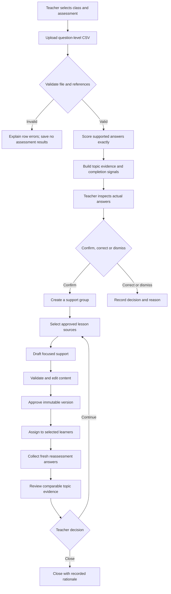
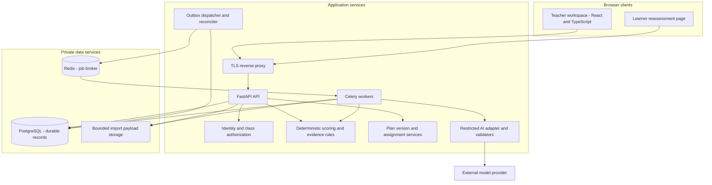
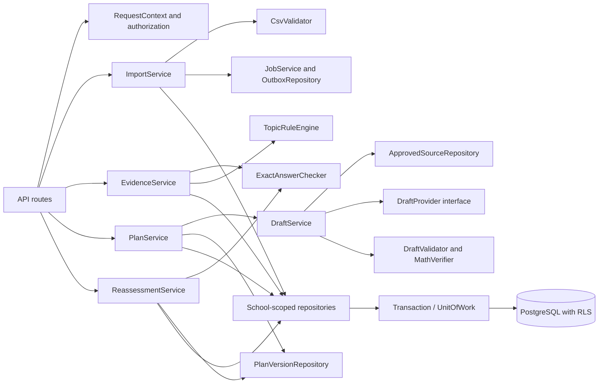
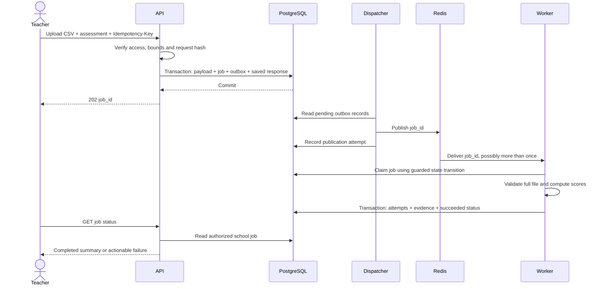
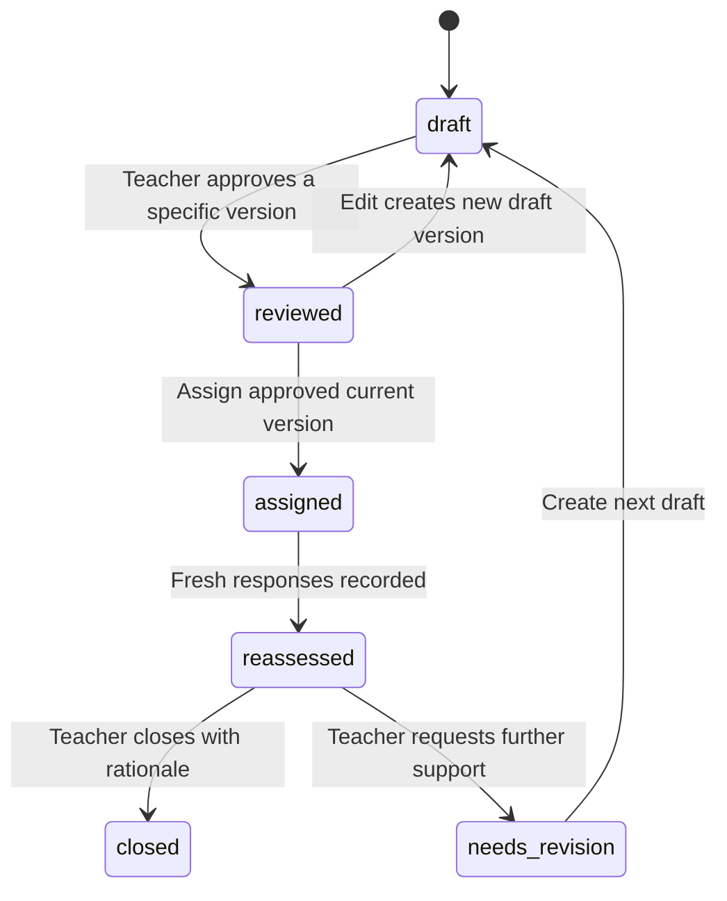
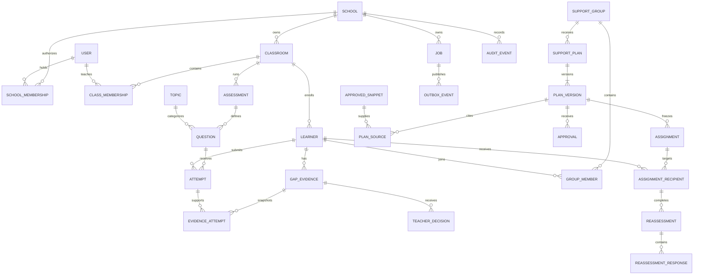
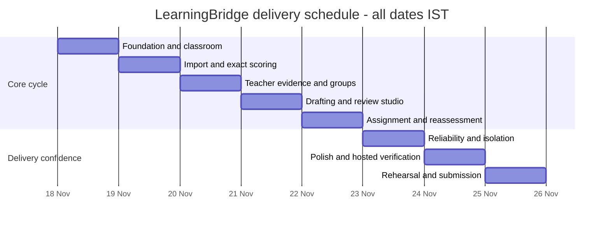

# LearningBridge — Detailed Prototype Implementation Plan

> **PRASUNEX INNOVATHON 2026 · Round 3: Prototype Development & Demonstration**  
> Development window: **18 November 2026, 09:00 IST – 25 November 2026, 23:00 IST**  
> Potential Final Jury: **1 December 2026**, subject to shortlisting.  
> Status: **Implementation blueprint; no prototype functionality is claimed complete.**  
> Planning baseline: `PROJECT_CONTEXT.md`. Existing reference files must be preserved.

## Contents

1. [Product objective and success definition](#1-product-objective-and-success-definition)
2. [Scope and delivery priorities](#2-scope-and-delivery-priorities)
3. [End-to-end product journey](#3-end-to-end-product-journey)
4. [System architecture](#4-system-architecture)
5. [Low-level design](#5-low-level-design)
6. [Data model and record ownership](#6-data-model-and-record-ownership)
7. [API contracts](#7-api-contracts)
8. [Phase 1 — Foundation and synthetic classroom](#8-phase-1--foundation-and-synthetic-classroom)
9. [Phase 2 — Import and deterministic assessment](#9-phase-2--import-and-deterministic-assessment)
10. [Phase 3 — Explainable teacher evidence workspace](#10-phase-3--explainable-teacher-evidence-workspace)
11. [Phase 4 — Grounded support drafting](#11-phase-4--grounded-support-drafting)
12. [Phase 5 — Approval, assignment and reassessment](#12-phase-5--approval-assignment-and-reassessment)
13. [Phase 6 — Reliability, security and measurement](#13-phase-6--reliability-security-and-measurement)
14. [Phase 7 — Product polish and deployment](#14-phase-7--product-polish-and-deployment)
15. [Phase 8 — Demonstration and submission](#15-phase-8--demonstration-and-submission)
16. [Test strategy and acceptance matrix](#16-test-strategy-and-acceptance-matrix)
17. [Schedule, dependencies and scope decisions](#17-schedule-dependencies-and-scope-decisions)
18. [Risks and contingency plans](#18-risks-and-contingency-plans)
19. [Build backlog and final definition of done](#19-build-backlog-and-final-definition-of-done)

---

## 1. Product objective and success definition

### 1.1 The classroom problem

An overall assessment mark can conceal a specific topic difficulty. A teacher also needs to inspect the underlying answers, decide whether support is warranted, prepare suitable material and review fresh evidence afterward. Moving between spreadsheets, lesson notes and separate quizzes makes this cycle difficult to trace.

**LearningBridge connects assessment evidence, teacher decisions, focused support and reassessment in one inspectable workflow.** It supports teacher judgment; a low topic score is a review signal, not a diagnosis of mastery or a learner's ability.

### 1.2 Demonstration scenario

- One Class 6 maths class with **40 explicitly synthetic learners**.
- Topics: **fractions, decimals and percentages**.
- A learner achieves **7/10 overall** but **1/3 on fractions**.
- Two supported errors include `1/2 + 1/3 = 2/5` and `1/4 + 1/2 = 1/3`.
- Correct answers are `5/6` and `3/4`. The teacher inspects the work before confirming a suspected gap.
- The teacher groups learners, drafts support from approved material, edits it, approves a version and assigns it.
- Learners answer fresh questions. The teacher reviews the new evidence and closes or revises the intervention.

Any prepared improvement in demo data is illustrative. There are no measured learning gains yet.

### 1.3 What success means

| Evaluation dimension | Concrete evidence in the prototype |
|---|---|
| Functionality | Persisted import → evidence → approved plan → assignment → reassessment |
| Technical execution | Exact scoring, versioned decisions, safe job recovery and meaningful automated checks |
| Usability | Teacher can understand a flag and act without reading implementation details |
| Innovation | Traceable intervention cycle linking the original evidence to subsequent action |
| Practical applicability | Realistic question-level CSV and a teacher-controlled classroom workflow |
| Scalability | Separate API/worker processes, indexed reads and reported measurements |
| Demonstration quality | Resettable synthetic scenario, concise story and visible failure handling |

No claim of global uniqueness, verified PRASUNEX feature absence or production readiness is required.

## 2. Scope and delivery priorities

### 2.1 P0 — Required working capability

1. Authenticated teacher access to assigned classes.
2. Validated CSV import and durable job status.
3. Exact answer checking for supported numeric questions.
4. Topic review signals with underlying evidence and rule version.
5. Teacher confirmation, correction or dismissal.
6. Explicit learner groups for a confirmed topic need.
7. Source-linked support drafting, with a teacher-authored fallback.
8. Teacher editing, immutable approved versions and assignment checks.
9. Fresh reassessment attached to the assigned approved plan.
10. Cross-school isolation, duplicate protection and an audit history.

### 2.2 P1 — Add after the full cycle works

- Printable support sheet generated from the approved version.
- Additional teacher-approved lesson templates.
- Teacher-reviewed parent message drafts; no autonomous sending.
- A concise school coordinator view using existing authorized read models.

### 2.3 Deferred scope

Live PRASUNEX integration, OCR, unrestricted free-form grading, a general AI tutor, broad curriculum coverage, automated parent communication and predictive learner risk scores are outside this build. API access to PRASUNEX is unverified. CSV is the working integration boundary.

## 3. End-to-end product journey



### Product navigation

| Screen | Main question it answers | Primary action |
|---|---|---|
| Class overview | Where should I look first? | Inspect a topic or learner |
| Import workspace | Can this assessment be processed? | Validate and import |
| Evidence explorer | Why was this flagged? | Confirm/correct/dismiss |
| Support studio | What should this group practise? | Edit and approve |
| Assignment detail | What did these learners receive? | Review completion |
| Learner quiz | What do I need to answer? | Submit fresh responses |
| Progress review | What evidence do we have now? | Close or revise |

## 4. System architecture

### 4.1 High-level component diagram



### 4.2 Architecture decisions and reasons

| Decision | Reason | Implementation consequence |
|---|---|---|
| Modular monolith API | An eight-day prototype needs simple deployment and clear boundaries | Modules share one API process and transaction manager |
| React + TypeScript | Interactive evidence views and explicit frontend contracts | Generate/check client types against the API schema |
| FastAPI + Pydantic | Request/response validation and discoverable contracts | Keep domain rules in services rather than route handlers |
| PostgreSQL | Evidence, approvals and assignments need relational integrity | Migrations, composite tenant keys and transactional writes |
| Celery + Redis | Imports and provider calls should not block interactive requests | Persist job state in PostgreSQL; Redis only transports work |
| Restricted provider adapter | Provider choice remains open | One interface supports live provider, test double and fallback behavior |
| Docker deployment | Repeatable local and hosted environments | Separate API, worker, dispatcher, database and broker services |

These are design choices from the accepted proposal. Exact package versions, hosting capabilities and provider credentials must be verified during setup and pinned after a working installation.

### 4.3 Deployment boundary

- Expose only the web entry point over HTTPS in the hosted environment.
- Keep PostgreSQL and Redis on private networks with authentication.
- Run migrations with a dedicated elevated database role; application connections use a restricted role.
- Use durable database storage and shared import storage accessible to API and worker processes.
- For the prototype, a bounded database payload table can simplify small CSV storage; keep storage behind an interface for later object storage.
- Keep credentials outside source control. Supply an example configuration containing names and non-secret placeholders only.
- Start on one measured host; independent processes do not imply unlimited scaling or high availability.

## 5. Low-level design

### 5.1 Module and dependency diagram



**Dependency rule:** route handlers parse input and call services; services enforce domain rules; repositories persist records within the active school transaction. Provider adapters never approve, assign or update learner evidence.

### 5.2 Principal interfaces

| Component | Input | Output / invariant |
|---|---|---|
| `RequestContext` | Verified identity and selected authorized school | Actor, school and role; body fields cannot override identity |
| `CsvValidator` | Bounded bytes, assessment and class references | Valid normalized rows or bounded row errors |
| `ExactAnswerChecker` | Question specification and response | Correct/incorrect/unattempted/invalid/requires_review, with awarded marks |
| `TopicRuleEngine` | Scored attempts and rule configuration | Score, counts, completion signal and review status |
| `EvidenceService` | Learner, assessment and topic | Immutable evidence snapshot plus teacher decisions |
| `DraftProvider` | Topic, grade and approved source text | Candidate content only |
| `DraftValidator` | Candidate and allowed source IDs | Validated candidate or structured rejection |
| `PlanService` | Plan operation and expected revision | Transactional new version/approval/assignment or conflict |
| `ReassessmentService` | Assignment, approved version and responses | Fresh evidence linked to that exact assignment |
| `JobService` | School, job kind and request hash | Durable job with idempotent processing |

### 5.3 Import sequence



Publication is at-least-once. A crash between publication and recording publication can send the same job again; unique constraints and idempotent job handling must make that harmless.

### 5.4 Plan lifecycle and versioning



`reviewed` means an approved version exists. Approval is an explicit record with actor, timestamp and version ID. Once assigned, lifecycle display belongs to the intervention/assignment; an edit creates a separate new draft and must not overwrite the already assigned version or rewind historical assignments. Multiple assignments can reference immutable versions independently.

### 5.5 Approval and assignment sequence

```mermaid
sequenceDiagram
    actor T as Teacher
    participant API
    participant P as PlanService
    participant DB as PostgreSQL
    T->>API: Approve(plan_id, expected_revision, version_id)
    API->>P: Authorized actor and validated request
    P->>DB: Lock plan; verify revision and content validity
    alt Stale revision
        P-->>T: 409 conflict; reload current version
    else Current revision
        P->>DB: Freeze version + approval + audit event
        P-->>T: Approved version reference
    end
    T->>API: Assign(expected_revision, approved_version_id, learners)
    API->>P: Assignment request
    P->>DB: Verify current approval and learner/class scope
    P->>DB: Save assignment referencing immutable version
    P-->>T: Assignment created
```

## 6. Data model and record ownership

### 6.1 Entity relationship diagram



### 6.2 Important fields and constraints

All school-owned records carry `school_id`. Global user identity is separated from school membership. Topic definitions can be school-owned for the prototype to simplify consistent isolation.

| Record | Important fields / constraints |
|---|---|
| `school_membership` | User, school, role, active status; unique school/user membership |
| `class_membership` | School, class, teacher; authorized teacher/class association |
| `learner` | School, class, external reference, synthetic flag; unique school/external reference |
| `assessment` | Class, name, grade, revision, import state |
| `question` | Assessment, external ID, topic, maximum marks, answer kind, validated structured specification, key |
| `attempt` | Learner, question, raw bounded response, normalized value, outcome, marks, scoring version; unique learner/question/assessment sitting |
| `gap_evidence` | Learner, topic, assessment, awarded/possible marks, item counts, rule version, evidence status |
| `teacher_decision` | Evidence ID, action, optional corrected topic, reason, actor and timestamp; append decisions |
| `support_group` / `group_member` | Topic, class, membership snapshot and confirmed evidence references |
| `support_plan` | Group, current draft reference, current approved reference, optimistic revision counter |
| `plan_version` | Plan, version number, immutable content snapshot, source snapshot, content hash, validation metadata |
| `approval` | Version, approver, timestamp; approval never points to mutable content |
| `assignment` | Plan/version, assigning actor, due date, revision and state |
| `assignment_recipient` | Assignment and learner; unique pair; immutable membership at assignment |
| `reassessment` | Recipient, assigned version, quiz version, submission state, decision |
| `job` | Kind, school, status, request hash, attempt count, heartbeat, failure code and result reference |
| `idempotency_record` | School, actor, operation, key, request hash, response code/body; unique scoped key |
| `outbox_event` | Job reference, dispatch state, next attempt, retry count |
| `audit_event` | Actor, action, entity reference, request ID, timestamp and bounded non-sensitive metadata |

### 6.3 Integrity and indexing

1. Give parent entities a unique `(school_id, id)` key and use composite foreign keys from child tenant records.
2. Use decimal/integer or rational-safe storage for computed marks; avoid binary floating-point decisions at threshold boundaries.
3. Index common reads starting with school and class/assessment/topic as appropriate.
4. Add unique constraints for attempt identities, group membership, plan version numbers and assignment recipients.
5. Store evidence inputs and rule version so later rule changes do not silently rewrite historical decisions.
6. Preserve question and source snapshots used by approved plans; editing a library snippet must not alter assigned content.
7. Restrict updates/deletes on approved versions and audit records for the runtime role. Use service rules plus database enforcement where practical.
8. Treat deletions and retention as explicit maintenance operations; never use a public demo reset against an arbitrary school.

## 7. API contracts

### 7.1 Endpoint inventory

| Method and path | Purpose | Key rules |
|---|---|---|
| `GET /v1/me` | Current identity and permitted schools/classes | Signed identity and active membership |
| `GET /v1/classes/{id}/overview` | Class topic map and pending actions | Assigned teacher or authorized coordinator |
| `POST /v1/imports` | CSV + assessment reference | Multipart upload; idempotency required; returns 202/job ID |
| `GET /v1/jobs/{id}` | Poll job result | Owning school only; sanitized failure details |
| `GET /v1/assessments/{id}/evidence` | Filtered, paginated evidence | Stable sorting and bounded page size |
| `POST /v1/evidence/{id}/decisions` | Confirm/correct/dismiss | Reason and expected revision for conflicting actions |
| `POST /v1/groups` | Save topic support group | Same class; confirmed evidence; explicit members |
| `GET /v1/snippets` | Approved material by grade/topic | Only approved compatible sources |
| `POST /v1/plans/drafts` | Draft using confirmed gap/group and sources | 202; idempotency; confirmed evidence required |
| `GET /v1/plans/{id}` | Versions, sources and approval status | School/class access |
| `PATCH /v1/plans/{id}/draft` | Save teacher edits | Expected revision; creates new version after approval |
| `POST /v1/plans/{id}/approve` | Approve exact content | Expected revision/version; 409 on stale content |
| `POST /v1/plans/{id}/assign` | Assign approved current version | Recipient scope; unique assignment operation |
| `GET /v1/assignments/{id}/quiz` | Assigned fresh questions | Recipient authorization; omit keys and rationales |
| `POST /v1/followups` | Submit answers for assigned version | Recipient, assignment and quiz version checks |
| `POST /v1/reassessments/{id}/decision` | Close or request revision | Teacher decision and rationale |

### 7.2 Response and error conventions

Use a common error envelope with `code`, user-readable `message`, `request_id` and optional bounded `details`. Never return provider secrets, database traces or another tenant's metadata.

- **401:** missing or invalid identity.
- **403:** authenticated identity lacks a known permitted operation.
- **404:** absent or inaccessible resource where hiding existence is appropriate.
- **409:** stale version, reused key with different payload or invalid workflow transition.
- **413:** upload exceeds configured bound.
- **422:** malformed values or unsupported input format.
- **429:** school quota/concurrency bound reached; include retry guidance when available.
- **503:** temporary dependency failure where no job was durably accepted.

### 7.3 Idempotency behavior

Scope a key to school, actor and operation. Hash normalized metadata and file bytes for import; hash the canonical draft request for drafting. Persist the accepted response and hash transactionally with the job. Same key and same request returns the original job/result. Same key and different request returns 409. A retry must not allocate another plan or assignment. Document retention duration before implementation.

## 8. Phase 1 — Foundation and synthetic classroom

**Target:** 18 November. **Dependency:** none. **Outcome:** a reproducible application skeleton with persistent classroom data.

### 8.1 Feature: repository and service foundation

**Why:** architecture needs an executable baseline before feature work; setup failures must surface early.

**How:**

1. Inspect existing files and any applicable repository instructions. Preserve `PROJECT_CONTEXT.md` and `reference/`.
2. Add `frontend/`, `backend/`, `infra/`, `fixtures/`, `tests/` and `docs/` without moving prior references.
3. Organize backend modules as `auth`, `classrooms`, `imports`, `scoring`, `evidence`, `plans`, `reassessments`, `jobs` and `audit`.
4. Add typed configuration validation, database migrations and structured logging with request IDs.
5. Build Docker services and readiness checks. A live process and a database-ready service need separate checks.
6. Verify and pin dependencies; include commands for installation, migrations, start, tests and reset.

### 8.2 Feature: teacher and school access

**Why:** learner records and teacher actions must have clear ownership from the first feature.

**How:**

1. Implement signed token verification with configured issuer, audience, expiry and algorithm allowlist.
2. Resolve school membership server-side; verify class assignment for class-specific operations.
3. Use a replaceable identity adapter. Prefer a standard OIDC flow if setup is available; a local seeded-account issuer must still use signed tokens and must be labelled demo authentication.
4. Never accept a browser-provided role or school as authority. A selected school is only a request to enter an already authorized context.
5. Establish transaction-local school context for database access and initial RLS policies.
6. Seed a second school with distinct fixtures immediately for isolation checks.

### 8.3 Feature: credible synthetic classroom

**Why:** the prototype needs both a coherent demo and data that exercises difficult cases.

**How:**

1. Seed 40 synthetic learners, 10 questions and three topics. Use a fixed fixture seed.
2. Include 3 fractions questions, 3 decimals questions and 4 percentages questions for the illustrative assessment.
3. Include the 7/10 learner, several similar fraction patterns, blank answers, boundary scores and strong topic performance.
4. Add separate malformed CSV fixtures and a small low-evidence assessment.
5. Write an expected-results manifest independently specifying important scores and flags.
6. Mark the environment and all learner screens as synthetic; avoid real student information.

**Deliverables:** service skeleton, migrations, two schools, teacher accounts, fixtures and setup README.

**Exit gate:** environment boots from documented steps; data survives restart; a teacher sees only their classes; first cross-school read test passes.

## 9. Phase 2 — Import and deterministic assessment

**Target:** 19 November. **Dependency:** Phase 1. **Outcome:** trustworthy assessment results.

### 9.1 Feature: explicit CSV contract

**Why:** ambiguous columns create unreliable downstream evidence.

**How:**

1. Publish a downloadable template and sample file.
2. Use one row per learner/question response. Suggested columns: `learner_ref`, `question_ref`, `topic_ref`, `question_text`, `answer_kind`, `expected_answer`, `max_marks`, `response`.
3. Assessment/class references come from the authorized upload context. Repeated question metadata must match across all rows for that question.
4. Validate UTF-8 decoding, required columns, field lengths, duplicate learner/question rows, class membership, topic allowlist and mark bounds.
5. Treat question text as display text, never executable content. Escape it in the interface.
6. Start with configurable limits such as 2 MB, 5,000 response rows and 100 reported row errors; confirm actual limits during implementation.
7. For the P0 path, use all-or-nothing import: validate the whole file before committing assessment results.
8. Protect any later CSV export against spreadsheet formula execution in user-controlled cells.

### 9.2 Feature: safe exact answer checker

**Why:** answer equivalence and threshold decisions cannot depend on loose string comparison or unsafe evaluation.

**How:**

1. Support bounded signed integers, finite decimal strings and fractions with a nonzero integer denominator.
2. Normalize approved Unicode/whitespace variants explicitly; reject unexpected operators, exponent syntax, extremely long numbers and unsupported text.
3. Convert validated strings to exact rational values using `Fraction`; never pass unvalidated expressions to `eval`.
4. Define answer formats per question. For a percentage-format question, require/document percentage units and normalize `50%` to `1/2`; do not silently guess what bare `50` means.
5. Return distinct outcomes: correct, incorrect, unattempted, invalid and requires teacher review.
6. Keep short numeric checking separate from free-form reasoning. Unsupported reasoning goes to teacher review.
7. Record checker version and normalized values; retain bounded original responses as evidence.

### 9.3 Feature: topic evidence rules

**Why:** teachers need a transparent signal with enough evidence to inspect.

**How:**

1. Calculate topic score as awarded marks divided by possible marks for valid, assessed responses.
2. For this prototype, blanks and invalid responses do not increase the assessed-item count; show their counts and coverage separately. They must never make a learner appear secure. A conventional overall assessment mark may count blanks as zero, but label its different denominator clearly.
3. Require at least three assessed items before applying the initial below-60% review rule.
4. Represent insufficient evidence explicitly, including zero denominator cases; never display a misleading 0% or 100% when no valid responses exist.
5. At exactly 60%, the below-60 rule does not flag. Still show completion concerns independently.
6. Store question/attempt IDs, numerator, denominator, count, rule version and coverage in the evidence snapshot.
7. Implement narrow repeated-error patterns only for structured, supported questions. Two matching examples permit a suspected pattern tag; teacher confirmation remains necessary.

The blank/invalid denominator convention above is an explicit implementation decision to validate before coding. It preserves the accepted separation between completion and topic evidence.

### 9.4 Feature: background import execution

**Why:** teachers need durable progress and useful failures when processing takes time.

**How:** create the payload/job/outbox transaction; dispatch job IDs; claim jobs with guarded transitions; process bounded chunks; commit final assessment results atomically; persist counts and failure codes. Use `queued`, `running`, `succeeded`, `failed` and `retry_pending` statuses. Poll with backoff and stop when terminal.

**Deliverables:** template, validator, scorer, rule engine, import API, status UI and boundary fixtures.

**Exit gate:** expected fixture results match; equivalent fractions/decimals pass; blanks stay distinct; bad imports write no results; repeated upload key returns the same job.

## 10. Phase 3 — Explainable teacher evidence workspace

**Target:** 20 November. **Dependency:** Phase 2. **Outcome:** a teacher can understand and act on results.

### 10.1 Feature: class learning map

**Why:** a list of total scores hides topic patterns and requires manual scanning.

**How:**

1. Query a paginated learner/topic read model instead of loading every raw attempt into the browser.
2. Display learners as rows and topics as columns. Each cell has a score/count plus text or symbol for review/insufficient evidence/completion concern.
3. Filter by topic and review status; preserve explicit sort order.
4. Open a detail panel from a cell. Provide a readable list alternative on narrow screens and for keyboard access.
5. Avoid ranking learners as weak/strong. Use task-oriented labels such as “Review fractions evidence.”

### 10.2 Feature: evidence explorer

**Why:** teachers must be able to challenge the system's suggestion.

**How:** show original question, submitted answer, verified key, awarded marks and topic tag; explain the score and rule in plain language; show all supporting attempts, not just selected errors. Display suspected error patterns separately from teacher-confirmed decisions. Corrections append a decision with actor/reason rather than modifying historical input silently.

### 10.3 Feature: support groups

**Why:** teachers can prepare one suitable activity for several learners with a similar confirmed need.

**How:** suggest members from the same class/topic with confirmed evidence; let the teacher add/remove eligible learners; require confirmation before saving; snapshot membership and evidence IDs. Do not cluster using hidden embeddings or unsupported psychological labels. Separate groups if the evidence indicates different instructional needs.

**Deliverables:** overview, evidence panel, decision endpoints, group editor and audit events.

**Exit gate:** each signal opens the correct answers and rule; teacher decisions persist; group creation rejects another class/school and unconfirmed evidence.

## 11. Phase 4 — Grounded support drafting

**Target:** 21 November. **Dependency:** Phase 3. **Outcome:** useful draft material with visible sources and teacher control.

### 11.1 Feature: approved lesson library

**Why:** bounded, relevant source material gives content generation a controlled classroom context.

**How:** store short teacher-approved snippets with topic, grade, language, source label, version and approval metadata. Seed a small curated library for three topics. Retrieve by exact compatible grade/topic/language; show sources before drafting. Require selected sources to remain approved at draft time and snapshot their content for later traceability.

### 11.2 Feature: provider-independent drafting

**Why:** provider configuration and availability should not control the entire classroom workflow.

**How:**

1. Define `DraftProvider.generate(context)` behind a narrow interface.
2. Send only topic, grade, language and approved snippet text/IDs. Exclude names, learner IDs, raw CSV and raw answers.
3. Separate system instructions from source text. Treat snippets as untrusted data and enable no model tools.
4. Request `topic_id`, `source_ids`, `explanation` and exactly three practice items containing question, answer and rationale.
5. For automatic maths verification, extend each numeric item with a supported structured specification: operation, operands and answer format. The displayed question must be rendered consistently from that specification. Free prose alone is insufficient to recompute a key reliably.
6. Validate topic/source allowlists, counts, lengths and schema. Recompute answers from the structured specification and reject mismatches.
7. Preserve provider/prompt/content versions, validation result and source lineage without storing secrets.

### 11.3 Feature: bounded execution and fallback

**Why:** unreliable generation must not stall or silently compromise the demo.

**How:** use configurable timeouts and at most two transient retries with backoff; do not retry schema failures indefinitely. Enforce school quotas and bounded worker/provider concurrency. Cache candidates by school, topic, grade, source-content hash, prompt version, provider configuration and language. Cache hits still require teacher review. On terminal failure, show the reason and offer a teacher-authored template as a new reviewable draft. Clearly identify AI-generated versus template content.

### 11.4 Feature: support studio

**Why:** structural validity does not establish instructional quality.

**How:** place editable explanation and practice items beside source references and group context. Show validation failures next to affected items. Save edits using optimistic revision checks. Any changes to a numeric item require revalidation before approval. Present a clear approval action and disclose that approval assigns responsibility for the selected content version.

**Deliverables:** source library, provider adapter, validators, fallback content, drafting job and review studio.

**Exit gate:** a live provider call is demonstrated if credentials are available; otherwise disclose template mode. Invalid keys and unknown sources are rejected; no learner identifiers appear in provider payload tests; unapproved content cannot be assigned.

## 12. Phase 5 — Approval, assignment and reassessment

**Target:** 22 November. **Dependency:** Phase 4. **Outcome:** the complete classroom cycle works.

### 12.1 Feature: immutable approval

**Why:** a teacher must know exactly what learners received even after later edits.

**How:** lock the plan or perform a conditional revision update in a transaction; validate the requested version; freeze its content/source snapshot; insert approval and audit event; increment revision. Return 409 if another editor changed the plan. Subsequent edits create a new draft version. Assignment references the approved version ID, never “latest content.”

### 12.2 Feature: assignment

**Why:** support becomes actionable only when there is an explicit recipient record and content reference.

**How:** validate current approval, teacher/class access and membership; create assignment and recipient rows atomically; protect replay with a unique operation identity. Record assigned content, actor and due date. Show completion separately from topic performance. Reassignment is an explicit new operation with a visible relationship to the prior one.

### 12.3 Feature: fresh reassessment quiz

**Why:** repeating the original questions can measure recall of those answers rather than provide fresh topic evidence.

**How:**

1. Maintain a small teacher-approved question bank with topic, difficulty band and structured numeric specifications.
2. Generate/select fresh items deterministically for the assigned topic, excluding original and practice item signatures.
3. Persist a quiz version tied to assignment and approved plan. Keep answer keys server-side.
4. For the prototype, use seeded learner accounts or scoped, expiring assignment access tokens bound to a recipient; do not expose arbitrary learner-ID submission.
5. Submit bounded answers and score with the same checker. Protect double submission with a documented submission key; teacher-authorized retakes create a new sitting.
6. Keep every recipient's results separate. Never treat one learner submission as completion for the whole group.

### 12.4 Feature: progress review and next action

**Why:** a workflow is incomplete until a teacher can decide what to do with the new evidence.

**How:** compare original and fresh topic evidence with counts, marks, completion and question differences. Avoid presenting different difficulty sets as a standardized gain score. Show individual responses and teacher observations. Require a reason to close or request revision. A new support cycle references the previous plan/evidence while preserving all prior records.

**Deliverables:** approval/version flow, assignment detail, learner quiz, reassessment service and progress review.

**Exit gate:** complete import → teacher confirmation → approved support → assignment → fresh submission → teacher decision on persisted data. Old assignments survive edits; stale approvals/assignments fail cleanly.

## 13. Phase 6 — Reliability, security and measurement

**Target:** 23 November. **Dependency:** full cycle. Security basics begin in Phase 1; this phase broadens verification.

### 13.1 Feature: database tenant isolation

**Why:** application filters alone are too easy to omit in a new endpoint or worker task.

**How:** enable RLS on all tenant tables; apply read and write checks to the transaction-local school context; use a runtime role without ownership, superuser or BYPASSRLS privileges. Test policy enforcement using that actual role. Ensure pooled connections cannot reuse a previous request's context. Every worker resolves school from its stored job and opens the same scoped transaction. Cross-school composite foreign keys block invalid references.

### 13.2 Feature: recoverable jobs

**Why:** queues can deliver twice, workers can crash and Redis can be unavailable.

**How:** persist job transitions and heartbeat; use bounded leases/claims; reconcile expired running jobs according to attempt limits; redispatch durable pending outbox events. Guard result writes with unique identities and transactions. Report progress only when backed by durable checkpoints. Test crashes before publication, after publication, during work and before final acknowledgement.

### 13.3 Feature: audit and operational visibility

**Why:** debugging and explaining a decision requires a trustworthy history.

**How:** record imports, evidence decisions, draft creation, approval, assignment and closure with actor/entity/request references. Use append-only application access. Log durations and failure categories without names, raw answers, tokens or snippet content. Provide operational health checks and a restricted diagnostic view rather than exposing internal errors to teachers.

### 13.4 Feature: measured performance

**Why:** scalability claims need a defined workload and results.

**How:** index observed slow queries; avoid per-learner query loops; paginate evidence; cap payload sizes and polling. Measure on a documented environment with warm/cold conditions, dataset, query mix, duration, error rate and percentiles.

**Proposed targets, not current results:** 2,000 supported response rows imported within 10 seconds; read API p95 under 1 second; 50 concurrent read sessions on 2 vCPU/4 GB RAM. Import time is measured from accepted job to persisted success with a running worker. Report queue delay separately. Exclude model latency from these targets and report it independently. Revise targets if measured conditions require it.

**Deliverables:** isolation suite, failure drill report, audit view and performance report.

**Exit gate:** no observed cross-school leakage; duplicate work creates no duplicates; terminal failures have actionable UI; measurements are honestly recorded.

## 14. Phase 7 — Product polish and deployment

**Target:** 24 November. **Dependency:** core workflow and reliability gates.

### 14.1 Feature: Bridge at Night design system

**Why:** a clear visual hierarchy makes the reasoning understandable during a short demonstration.

**How:** define tokens for navy `#0B1020`, indigo `#151B3A`, violet `#7C5CFF`, cyan `#22D3EE`, amber `#FFB547`, mint `#34D399`, coral `#FF6B6B` and light relief `#F6F3EC`. Test contrast in actual components; color must accompany text/icons. Use Segoe UI/Calibri-compatible fallbacks. Reserve amber for teacher decisions, cyan for system evidence and mint for validated states. Never use color as the sole meaning carrier.

Use varied task-based layouts: broad class map, focused evidence panel, document-like support editor and chronological progress review. Keep decorative motion minimal and respect reduced-motion preferences.

### 14.2 Feature: complete interaction states

**Why:** a product feels reliable when it explains waiting, emptiness and failure.

**How:** specify loading, empty, validation error, authorization failure, timeout and stale-edit states for every screen. Preserve unsaved edits where safe; require revalidation after conflicts. Provide keyboard navigation, labelled controls, visible focus and responsive reflow. Use plain teacher language rather than database/job terminology where possible.

### 14.3 Feature: repeatable deployment

**Why:** the deployed environment is the product judges will experience.

**How:** build pinned images; run migrations once; provision secrets; serve HTTPS; keep data services private; seed only explicit synthetic demo tenants. Back up the database before schema changes. Verify restore into a disposable database. Separate liveness from readiness. Document rollback steps and keep a known-good release available.

**Deliverables:** deployed build, design tokens, accessibility pass, environment guide and rollback notes.

**Exit gate:** full journey succeeds through the hosted URL; browser refresh preserves state; no secret reaches frontend assets; narrow-screen and keyboard paths remain usable.

## 15. Phase 8 — Demonstration and submission

**Target:** 25 November. Feature freeze at midday; internal submission target **20:00 IST**, three hours before the official deadline.

### 15.1 Feature: resettable demonstration

**Why:** repeatable starting conditions prevent accidental missing evidence during presentation.

**How:** provide a restricted local/admin reset command that targets only an explicitly identified synthetic demo tenant. Require a demo-environment guard and preserve other tenants. Verify reset, import and the complete walkthrough from scratch. Keep a separate prepared dataset for a concise live demonstration; disclose when results are preloaded.

### 15.2 Five-minute narrative

| Segment | Action | Point demonstrated |
|---|---|---|
| 0:00–0:40 | Show the 7/10 assessment | Overall marks can conceal topic needs |
| 0:40–1:30 | Import and open the learning map | Real data processing and usable overview |
| 1:30–2:15 | Inspect wrong answers and confirm | Explainability and teacher control |
| 2:15–3:15 | Draft, edit and approve support | Grounded assistance and immutable approval |
| 3:15–4:15 | Submit fresh answers and review | Complete intervention cycle |
| 4:15–5:00 | Show duplicate replay or AI fallback | Reliability and practical engineering |

Adjust this duration if organizers publish a different limit. Keep other failure cases available for questions rather than interrupting the main story.

### 15.3 Submission package

- Working prototype URL or documented local run path, according to submission rules.
- README, synthetic fixture/template and demonstration account instructions.
- Concise architecture/LLD and feature coverage summary.
- Test and measurement report with actual outcomes and limitations.
- Walkthrough recording and backup screenshots, clearly distinguished from live functionality.
- Known limitations: supported formats, curriculum scope, provider mode and absence of live ERP integration.

Verify actual organizer submission fields before packaging; no particular repository, video duration or hosting format is assumed here.

## 16. Test strategy and acceptance matrix

### 16.1 Test layers

| Layer | Purpose | High-value checks |
|---|---|---|
| Domain unit tests | Verify independent rules | Rational equivalence, boundary scores, pattern support and state transitions |
| PostgreSQL integration | Verify persistence and authorization | RLS, composite keys, approved-version immutability and transactions |
| API integration | Verify contracts and permissions | Idempotency, malformed input, stale revisions and learner submission scope |
| Worker integration | Verify recovery | Duplicate delivery, broker outage and worker interruption |
| Browser end-to-end | Verify complete user journeys | One full intervention; one invalid import; one edit conflict |
| Manual usability review | Verify comprehension and interaction | Teacher wording, contrast, keyboard use and narrow screens |
| Load measurement | Establish practical limits | Defined import/read workloads and error rates |

Use actual PostgreSQL for RLS tests and an actual worker/broker for recovery drills. Mocks alone cannot establish those properties.

### 16.2 Acceptance cases

| ID | Scenario | Expected result |
|---|---|---|
| A01 | `1/2`, `2/4`, `0.5` for equivalent numeric key | All accepted when question format allows |
| A02 | `1/0`, code-like input, huge integer or unexpected syntax | Bounded validation error; no evaluation |
| A03 | Blank response | Unattempted; completion signal; denominator convention applied |
| A04 | Two assessed topic items | Insufficient evidence regardless of percentage |
| A05 | Three assessed items below 60% | Review suggested with linked evidence |
| A06 | Exactly 60% | Below-60 rule does not flag |
| A07 | Conflicting question metadata across CSV rows | Entire import rejected with useful row references |
| A08 | Replay same import key and bytes | Same job/result; no extra attempts |
| A09 | Same key, different payload | 409; original work unchanged |
| A10 | School A guesses School B job/learner/plan ID | No data disclosed or changed |
| A11 | Pooled connection reused across schools | No previous school context persists |
| A12 | Unconfirmed gap used for drafting | Request rejected |
| A13 | Provider returns unknown source or wrong key | Candidate rejected; no assignable content |
| A14 | Provider timeout and retry exhaustion | Terminal reason and template option |
| A15 | Two editors approve different revisions | Stale request returns 409 |
| A16 | Edit after approval/assignment | New draft; prior recipient content unchanged |
| A17 | Reassessment for wrong learner/version | Rejected before recording evidence |
| A18 | Answer key requested from learner quiz endpoint | Key/rationale absent |
| A19 | Worker receives a completed job twice | No duplicate results |
| A20 | Broker unavailable after API commit | Durable job remains; dispatcher later recovers |
| A21 | No assessed valid responses | Insufficient evidence; no division by zero |
| A22 | Teacher changes a source library entry | Historical approved plan retains its source snapshot |

## 17. Schedule, dependencies and scope decisions



### 17.1 Critical path

Validated fixtures → import/scoring → evidence confirmation → support draft → immutable approval → assignment → fresh reassessment → teacher closure.

Implement reliability constraints with their features; Phase 6 is dedicated verification, not the first time security and recovery are considered.

### 17.2 Scope decisions when time is tight

1. If Phase 2 slips, reduce question formats and optional UI filters; preserve exact scoring and validation.
2. If drafting slips, deliver the reviewed template path first and label it accurately. Keep the adapter contract for later provider wiring.
3. If the full cycle is incomplete on 22 November, freeze P1 features and stop adding dashboards or subjects.
4. If deployment is uncertain on 24 November, establish a documented local Docker demonstration and recording while continuing hosted fixes.
5. Never trade away tenant isolation, immutable assigned content or truthful demonstration labels to add visual effects.

### 17.3 Daily working method

- Begin with one phase acceptance target and a small concrete task list.
- Implement the smallest complete feature path, including persistence and the relevant failure state.
- Run targeted tests; broaden only when changes or failures justify it.
- Update actual phase status and record limitations.
- End with a runnable checkpoint and a short demonstration of that day's outcome.

## 18. Risks and contingency plans

| Risk | Early signal | Response |
|---|---|---|
| Excess scope | Several screens exist but no complete journey | Prioritize critical path; cut P1 features |
| Model credentials unavailable | Provider spike cannot run | Template mode with explicit disclosure; retain adapter |
| Invalid generated maths | Schema passes but recomputed answer differs | Structured numeric items, deterministic verification and rejection |
| Weak evidence interpretation | Few valid answers or many blanks | Insufficient-evidence and completion states; teacher review |
| Queue inconsistency | Job stuck despite committed request | Durable outbox, leases and reconciliation |
| Version race | Teacher approves content another editor changed | Expected revision, transaction and visible conflict |
| Data leakage | Test role can query another school | Block release until RLS and authorization tests pass |
| Deployment problems | Local-only state or missing shared storage | Early hosted smoke test, durable storage and rollback |
| Overstated results | Demo suggests validated learning improvement | Label synthetic outcomes and state pilot requirements |
| Submission uncertainty | Missing format or duration information | Verify organizer instructions before final packaging |

### Pilot after the competition prototype

Measure teacher preparation time, edit/rejection rate, plan completion and reasoning on fresh questions against the existing workflow. Collect teacher feedback and appropriate permissions before using real classroom data. A small uncontrolled pilot does not establish causal improvement. Legal compliance certification is not claimed.

## 19. Build backlog and final definition of done

### 19.1 Ordered implementation checklist

- [ ] P1.1 Preserve references; create service skeleton and pinned configuration.
- [ ] P1.2 Migrate schema; seed two schools and 40 synthetic learners.
- [ ] P1.3 Implement verified identity, class authorization and initial RLS.
- [ ] P2.1 Publish CSV template and implement full-file validation.
- [ ] P2.2 Implement exact checker and topic-rule boundary tests.
- [ ] P2.3 Implement durable import jobs, outbox and replay protection.
- [ ] P3.1 Build class learning map and evidence explorer.
- [ ] P3.2 Persist teacher decisions and explicit support groups.
- [ ] P4.1 Seed approved sources and teacher-authored templates.
- [ ] P4.2 Implement restricted provider adapter and deterministic content validation.
- [ ] P4.3 Build support studio and clear fallback states.
- [ ] P5.1 Implement immutable approval and stale-version conflicts.
- [ ] P5.2 Assign exact versions to explicit recipients.
- [ ] P5.3 Deliver fresh quiz, scoped submission and progress decisions.
- [ ] P6.1 Complete two-school, replay, concurrency and interruption checks.
- [ ] P6.2 Measure import/read workloads; record actual results.
- [ ] P7.1 Finish product states, accessibility and responsive layouts.
- [ ] P7.2 Verify hosted persistence, backup/restore and rollback.
- [ ] P8.1 Rehearse from reset state; prepare backup recording.
- [ ] P8.2 Verify submission requirements and deliver before deadline.

### 19.2 Definition of done

The prototype is ready when a teacher can complete the entire intervention journey on persisted synthetic data; every important decision is traceable; incorrect input and unavailable dependencies have useful outcomes; tenant isolation and version safety are verified; and the final presentation clearly distinguishes implemented behavior, prepared demo data, measured results and future work.

**The strongest demonstration is one classroom problem solved from beginning to end, with enough engineering depth that judges can inspect how it works.**
