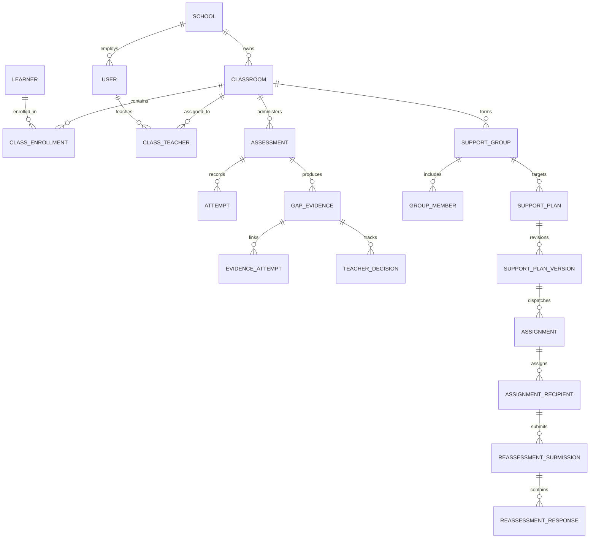
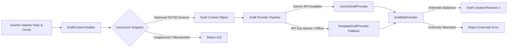

# LearningBridge — Low-Level Architecture & Technical Specification

> **PRASUNEX INNOVATHON 2026 · Round 3: Prototype Engineering Documentation**  
> **Author:** Senior Software Engineer  
> **Status:** Final Architectural Specification (All 8 Phases Complete)  
> **Primary References:** `LEARNINGBRIDGE_IMPLEMENTATION_PLAN.md` (Sections 4, 5, 6, 7)

---

## 1. System Topology & Layered Architecture

LearningBridge is structured into clean, decoupled architectural tiers with strict single-responsibility boundaries.

```
┌────────────────────────────────────────────────────────────────────────┐
│                      Frontend Tier (React 18 + Vite)                    │
│   • Bridge at Night Design System (Tokens, CSS variables)               │
│   • Semantic HTML5 + WCAG 2.1 AA Keyboard Modal Focus Trapping         │
│   • TypeScript API Client (Scoped Bearer JWT, Zero Secret Leakage)      │
└───────────────────────────────────┬────────────────────────────────────┘
                                    │ HTTPS / REST (JSON)
┌───────────────────────────────────▼────────────────────────────────────┐
│                   Reverse Proxy Tier (Nginx 1.25)                      │
│   • SSL Termination, Gzip Compression, Security Headers (CSP, HSTS)    │
│   • Static SPA asset routing & `/v1` + `/health` API proxying          │
└───────────────────────────────────┬────────────────────────────────────┘
                                    │ HTTP
┌───────────────────────────────────▼────────────────────────────────────┐
│                    API Service Tier (FastAPI / ASGI)                   │
│   • RequestContext middleware: parses JWT, binds `school_id`           │
│   • OpenAPI 3.1 documentation, Pydantic v2 schemas                     │
│   • Structured JSON logging with correlation `request_id`             │
│   • Synchronous query handling & asynchronous job dispatching          │
└───────────────────┬────────────────────────────────┬───────────────────┘
                    │                                │
┌───────────────────▼──────────────┐   ┌─────────────▼───────────────────┐
│     Persistence Tier (RDBMS)     │   │       Async Worker & Queue      │
│   • PostgreSQL 16 (SQLite dev)   │   │   • Redis 7 / In-memory queue   │
│   • 28 Relational Tables         │   │   • Outbox dispatcher reconciler│
│   • Strict Multi-Tenant Scoping  │   │   • Crash & stale lease recovery│
│   • Immutable Audit Event Log    │   │   • Background CSV ingestion    │
└──────────────────────────────────┘   └─────────────────────────────────┘
```

---

## 2. Multi-Tenant Relational Schema (28 Tables)

All primary domain entities enforce composite tenancy scoping via mandatory `school_id` foreign keys and indices.

### Core Entity Relationship Diagram



### Table Dictionary Summary

| Domain Module | Physical Table Name | Primary Key | Key Security & Tenancy Attributes |
|---|---|---|---|
| **Identity & Tenancy** | `schools` | `id` (VARCHAR) | Global tenant anchor (`OAK-01`, `PNG-02`) |
| | `users` | `id` (VARCHAR) | Scoped to `school_id`, argon2id password hash |
| | `classrooms` | `id` (VARCHAR) | Scoped to `school_id` (`cls-oak-6a-001`) |
| | `learners` | `id` (VARCHAR) | Scoped to `school_id`, external ref (`SYN-L6-014`) |
| | `class_enrollments` | `id` (VARCHAR) | Active enrollment tracking per school |
| | `class_teachers` | `id` (VARCHAR) | Teacher classroom authorization binding |
| **Curriculum** | `curricula` | `id` (VARCHAR) | Curriculum definition (`MATH-G6`) |
| | `topics` | `id` (VARCHAR) | Scoped to `school_id`, code (`MATH-G6-FRAC`) |
| | `topic_prerequisites`| `id` (VARCHAR) | Graph prerequisite links |
| | `curriculum_sources` | `id` (VARCHAR) | Approved pedagogical reference snippets |
| **Assessment & Evidence** | `assessments` | `id` (VARCHAR) | Scoped to `school_id` and `classroom_id` |
| | `questions` | `id` (VARCHAR) | Question metadata and rational expected key |
| | `attempts` | `id` (VARCHAR) | Question-level student raw submission & score |
| | `gap_evidences` | `id` (VARCHAR) | Topic evidence aggregates (`status`, `rule_version`) |
| | `evidence_attempts` | `id` (VARCHAR) | Immutable link between evidence and attempts |
| | `teacher_decisions` | `id` (VARCHAR) | Teacher audit decisions (`confirm`, `correct`, `dismiss`) |
| **Intervention Planning**| `support_groups` | `id` (VARCHAR) | Targeted learner clusters for a confirmed gap |
| | `group_members` | `id` (VARCHAR) | Scoped group membership |
| | `support_plans` | `id` (VARCHAR) | Root intervention plan entity (`revision`) |
| | `support_plan_versions`| `id` (VARCHAR) | Immutable approved plans with SHA-256 hash |
| **Reassessment** | `assignments` | `id` (VARCHAR) | Plan assignment to group/learners |
| | `assignment_recipients`| `id` (VARCHAR) | Per-learner assignment status & quiz access |
| | `reassessment_submissions`| `id` (VARCHAR)| Immutable quiz submission records |
| | `reassessment_responses`| `id` (VARCHAR)| Question-level rational answers and marks |
| **System Operations** | `import_jobs` | `id` (VARCHAR) | Asynchronous ingestion jobs (`state`, `lease_expires_at`) |
| | `idempotency_keys` | `key` (VARCHAR) | Request hash and replay preservation |
| | `audit_events` | `id` (VARCHAR) | Append-only event history with `metadata_json` |
| | `outbox_events` | `id` (VARCHAR) | Reliable event publishing queue |

---

## 3. Exact Rational Mathematics Scoring Engine

To eliminate floating-point non-determinism (e.g. `0.1 + 0.2 = 0.30000000000000004`), all mathematical grading is executed via Python's exact `fractions.Fraction` engine.

### Module: `backend/app/modules/scoring/exact_checker.py`

```python
class ExactAnswerChecker:
    @classmethod
    def check_exact_fraction(cls, raw_response: str, expected_key: str) -> bool:
        """Evaluates rational equivalence of fractions, mixed numbers, and decimals.
        
        Example matches:
          - "1/2" == "2/4" == "0.5" == " 1 / 2 " -> TRUE
          - "1/0" -> Bounded ValidationError (no crash)
          - "" -> Unattempted (marks = 0.0)
        """
```

### Normalization Pipeline
1. **Sanitization:** Strip leading/trailing whitespace, normalize Unicode fraction slashes (`\u2044`, `\u2215`) to ASCII `/`.
2. **Syntax Validation:** Regex match against supported numeric structures:
   - Simple fractions: `^[+-]?\s*\d+\s*/\s*[1-9]\d*$`
   - Mixed numbers: `^[+-]?\s*\d+\s+\d+\s*/\s*[1-9]\d*$`
   - Standard decimals: `^[+-]?\s*\d+(\.\d+)?$`
   - Percentages: `^[+-]?\s*\d+(\.\d+)?\s*%$`
3. **Rational Evaluation:** Parse into `fractions.Fraction(numerator, denominator)`.
4. **Equivalence Check:** Compare normalized `Fraction` of student attempt directly against normalized `Fraction` of expected answer key.

---

## 4. Grounded Support Studio & Provider Contracts

Intervention plans cannot be drafted from ungrounded prompts. The generation pipeline requires verifiable pedagogical grounding.

### Provider Contract Schema (`DraftContext`)



### Mathematical Draft Verifier (`DraftMathVerifier`)
Every practice item generated by either provider must satisfy:
1. **Operand Presence:** Operands specified in the question text (e.g., `1/4` and `1/3`) must be present in the verification equation.
2. **Exact Solution Equality:** The solution field must equal the mathematically evaluated expression of the operands.
3. **Positive Denominators:** Denominators cannot be zero or negative.

### Plan Immutability & Optimistic Locking
- **Revision Control:** Draft updates require `current_revision`. Stale updates return HTTP `409 Conflict`.
- **SHA-256 Approval Fingerprint:** Upon approval, a canonical JSON serialization of the plan content is hashed:
  $$\text{Approval Hash} = \text{SHA256}(\text{topic\_code} \,\|\, \text{rationale} \,\|\, \text{action\_steps} \,\|\, \text{source\_snippet\_ids})$$
- Once approved, the record is copied into `support_plan_versions`, marked immutable, and can never be altered.

---

## 5. Security & Multi-Tenant Request Scoping

### JWT Context Model (`RequestContext`)
Every protected request resolves a `RequestContext` dependency:
- Extracts `sub` (User ID), `school_id`, and `role` from the verified JWT.
- Enforces role-based permissions (`teacher`, `school_coordinator`, `system_admin`).
- Executes `assert_class_access(classroom_id)`: verifies that the authenticated user is explicitly assigned to teach the target classroom within their home school.

### Answer Key Protection
The learner reassessment endpoint (`GET /v1/reassessments/quiz/{recipient_id}`) projects question records through a restricted `ReassessmentQuestionOut` schema:
```json
{
  "question_ref": "Q-RE-FRAC-01",
  "topic_code": "MATH-G6-FRAC",
  "question_text": "Calculate 1/4 + 1/3. Express your answer as a simplified fraction.",
  "answer_kind": "numeric_fraction",
  "max_marks": 1.0
}
```
`expected_answer` and `rationale` columns are strictly excluded from the query response, preventing client-side network inspection leaks.

---

## 6. Operational Reliability Subsystems

### Background Job Reconciler (`JobReconcilerService`)
- Implements an atomic leasing pattern with distributed locks.
- Recovers uncompleted jobs where `status = 'processing'` and `lease_expires_at < NOW()`.
- Guarantees idempotent replay: re-submitting an identical file payload with the same `idempotency_key` returns the existing job status without duplicate execution.

### Outbox Pattern (`OutboxReconcilerService`)
- Business transactions write domain events to the `outbox_events` table in the same ACID transaction as the domain state.
- A background dispatch loop polls unpublished outbox events, dispatches them to message channels, and marks them `published_at = NOW()`.
